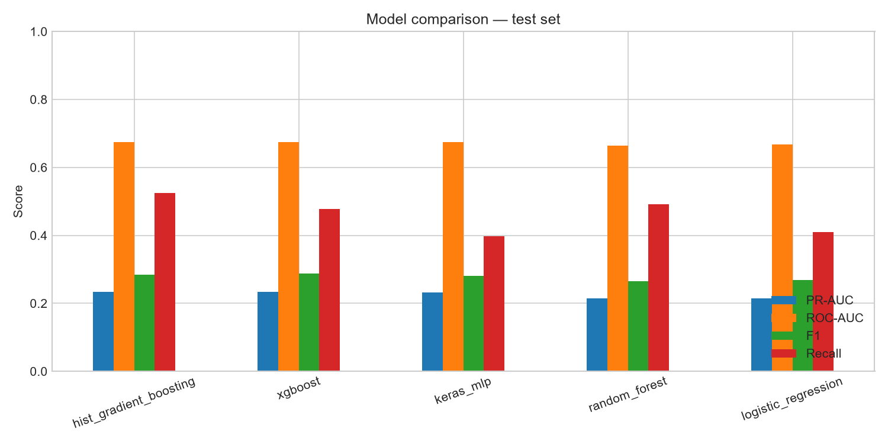
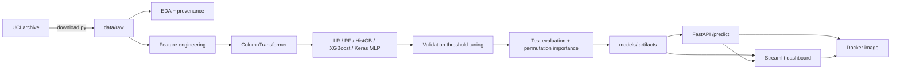

# 30-Day Hospital Readmission Prediction

End-to-end machine learning pipeline for predicting whether a diabetic patient
will be readmitted to hospital within 30 days of discharge.

The project covers the full lifecycle: data acquisition and provenance, advanced
feature engineering, multi-model training and comparison, deep learning,
evaluation, interpretability, API deployment, an analytics dashboard, container
images, automated tests and documentation.

## Highlights

- **101,766 patient encounters** from 130 US hospitals (1999–2008), 71,518 unique patients.
- **36 engineered features** (from 50 raw columns) expanded to **157 model inputs**.
- **Five models compared**: logistic regression, random forest, histogram gradient
  boosting, XGBoost and a TensorFlow/Keras MLP.
- **Patient-aware, stratified split** (`StratifiedGroupKFold` on `patient_nbr`) to
  prevent leakage between train, validation and test.
- **Class-imbalance strategy**: balanced class weights, PR-AUC-first model selection,
  F1-optimized decision threshold.
- **Deployment**: FastAPI service with single and batch endpoints, Streamlit
  dashboard, Dockerfile and Docker Compose.
- **Quality gates**: 12 pytest tests, ruff-clean code, API and dashboard smoke tests.

## Results

Selected model: **XGBoost** (highest validation PR-AUC). Test-set performance at the
tuned threshold of **0.53**:

| Model | Val PR-AUC | Test PR-AUC | Test ROC-AUC | Test F1 | Test recall | Test precision |
|---|---:|---:|---:|---:|---:|---:|
| **XGBoost (selected)** | **0.2291** | **0.2345** | 0.6748 | 0.2877 | 0.4778 | 0.2058 |
| Hist. gradient boosting | 0.2285 | 0.2346 | 0.6754 | 0.2840 | 0.5240 | 0.1948 |
| Keras MLP | 0.2260 | 0.2321 | 0.6753 | 0.2807 | 0.3970 | 0.2171 |
| Logistic regression | 0.2209 | 0.2145 | 0.6677 | 0.2694 | 0.4106 | 0.2004 |
| Random forest | 0.2124 | 0.2147 | 0.6649 | 0.2648 | 0.4920 | 0.1811 |

The positive class prevalence is 11.16%, so the selected model's test PR-AUC of
0.2345 is **2.1× the no-skill baseline**. Histogram gradient boosting is
statistically tied with XGBoost; the selection was made strictly on validation
PR-AUC before the test set was examined.

Key drivers (permutation importance, ROC-AUC loss): prior inpatient visits,
inpatient ratio, discharge disposition, number of diagnoses, total prior visits,
length of stay and medical specialty.



## Dataset

**Diabetes 130-US Hospitals for Years 1999-2008** (UCI Machine Learning Repository)

- 101,766 encounters, 50 columns, 130 hospitals, years 1999–2008.
- Target: `readmitted` — `<30` maps to 1 (readmitted within 30 days), `>30` and `NO` map to 0.
- Positive rate: 11.16% (11,357 / 101,766).
- License: CC BY 4.0. DOI: [10.24432/C5230J](https://doi.org/10.24432/C5230J).

The dataset is downloaded automatically by `src/data/download.py`; the raw CSV is
not committed. Provenance (source URL, SHA-256, download timestamp, shape) is
written to `data/raw/provenance.json`.

## Architecture



Detailed diagrams and data contracts: [`docs/architecture.md`](docs/architecture.md).

## Repository layout

```
.
├─ api/                     FastAPI service (schemas + app)
├─ dashboard/               Streamlit analytics app
├─ data/
│  ├─ raw/                  downloaded dataset + provenance (gitignored)
│  └─ processed/            split dataset parquet (gitignored)
├─ docs/
│  ├─ architecture.md       pipeline, data contracts, deployment diagrams
│  └─ model_card.md         model card and responsible-use notes
├─ models/                  trained artifacts + metadata
├─ notebooks/               EDA notebook
├─ reports/
│  ├─ figures/              EDA and model diagnostics
│  ├─ metrics/              metrics.json, comparison, importance, EDA summary
│  ├─ final_report.md       full project report
│  └─ presentation.html     slide deck
├─ scripts/                 pipeline, EDA and API smoke scripts
├─ src/
│  ├─ config.py             paths, schema, constants
│  ├─ data/download.py      acquisition, provenance, loading
│  ├─ features/build.py     feature engineering + preprocessor
│  └─ models/               train, evaluate, predict
├─ tests/                   unit, API and artifact smoke tests
├─ Dockerfile
├─ docker-compose.yml
├─ requirements.txt
└─ requirements-dev.txt
```

## Quickstart

### 1. Environment

Python 3.12 is required (TensorFlow 2.21, scikit-learn 1.9).

```powershell
py -3.12 -m venv .venv
.\.venv\Scripts\Activate.ps1
python -m pip install --upgrade pip
pip install -r requirements.txt -r requirements-dev.txt
```

> **Windows long-path note.** TensorFlow contains deeply nested header paths. If
> the project lives in a long path (for example under OneDrive) and
> `pip install tensorflow` fails with `No such file or directory`, enable Windows
> long paths or place the environment on a short path and link it:
>
> ```powershell
> $short = "$env:LOCALAPPDATA\venvs\cognevance_ml"
> py -3.12 -m venv $short
> New-Item -ItemType Junction -Path .venv -Target $short
> & "$short\Scripts\python.exe" -m pip install -r requirements.txt -r requirements-dev.txt
> ```
>
> This repository was set up with exactly this workaround; `.venv` is a junction
> to `%LOCALAPPDATA%\venvs\cognevance_ml`.

### 2. Run the pipeline

```powershell
.\.venv\Scripts\python.exe scripts\run_pipeline.py
```

This downloads the dataset, runs EDA, trains all five models, tunes thresholds,
evaluates on the held-out test set, computes permutation importance and writes
all artifacts and figures. Useful flags: `--quick`, `--skip-keras`,
`--skip-eda`, `--skip-download`, `--force-download`.

### 3. Serve the API

```powershell
.\.venv\Scripts\python.exe -m uvicorn api.main:app --host 0.0.0.0 --port 8000
```

Swagger UI: <http://localhost:8000/docs>. Endpoints:

| Method | Path | Purpose |
|---|---|---|
| GET | `/health` | Liveness and model-loaded status |
| GET | `/model/info` | Model, threshold, metrics, versions |
| POST | `/predict` | Score a single encounter |
| POST | `/predict/batch` | Score a CSV (max 10,000 rows), returns CSV |

```powershell
curl.exe http://localhost:8000/health

curl.exe -X POST http://localhost:8000/predict `
  -H "Content-Type: application/json" `
  -d '{\"age\":\"[70-80)\",\"gender\":\"Female\",\"time_in_hospital\":6,\"num_medications\":22,\"number_inpatient\":2,\"number_emergency\":1,\"number_diagnoses\":9,\"diag_1\":\"428\",\"diag_2\":\"250\",\"diag_3\":\"401\",\"insulin\":\"Up\",\"A1Cresult\":\">7\",\"change\":\"Ch\",\"diabetesMed\":\"Yes\"}'

curl.exe -X POST http://localhost:8000/predict/batch -F "file=@data/raw/diabetic_data.csv"
```

Run the smoke test against a live server:

```powershell
.\.venv\Scripts\python.exe scripts\smoke_api.py
```

### 4. Launch the dashboard

```powershell
.\.venv\Scripts\python.exe -m streamlit run dashboard/app.py
```

Open <http://localhost:8501>. Pages: Overview, Data Insights, Model Performance,
Predict (live form) and Batch Predict (CSV upload/download). The dashboard uses
the API when available and falls back to the local artifact otherwise.

### 5. Tests and linting

```powershell
.\.venv\Scripts\python.exe -m pytest -q
.\.venv\Scripts\python.exe -m ruff check .
```

### 6. Docker

```powershell
docker compose up --build
```

API on port 8000, dashboard on port 8501. The image installs runtime requirements
and copies the trained artifacts.

## Pipeline details

1. **Acquisition** — UCI ZIP download, extraction, SHA-256 provenance.
2. **EDA** — target balance, missingness, readmission rates by age, length of
   stay, prior utilization and insulin regimen (`reports/figures`).
3. **Cleaning** — drop `encounter_id`, `patient_nbr` (from features), `weight`
   (96.9% missing) and `payer_code` (39.6% missing); preserve `None` as a valid
   lab category; map `?` to `Unknown`.
4. **Feature engineering** — ICD-9 diagnosis grouping, age midpoints, active and
   changed medication counts, insulin/medication aggregates, prior-visit totals
   and ratios, procedures/medications per day, high-utilizer and polypharmacy
   flags.
5. **Preprocessing** — median imputation + standard scaling for numerics;
   constant imputation + one-hot encoding with `min_frequency=20` and
   `infrequent_if_exist` handling for categoricals.
6. **Splitting** — 7-fold `StratifiedGroupKFold` on `patient_nbr`; folds 0/1 are
   test/validation (~14% each), the remaining folds form the training set.
7. **Modeling** — balanced class weights, fixed seeds, early stopping for
   HistGB/XGBoost/Keras.
8. **Evaluation** — accuracy, precision, recall, F1, ROC-AUC, PR-AUC, Brier,
   confusion matrix, ROC/PR curves, calibration and permutation importance.
   Threshold chosen on validation to maximize F1; test set used once.
9. **Persistence** — `best_model.joblib`, `preprocessor.joblib`,
   `keras_model.keras`, `metadata.json`.

## Configuration

All paths, column lists, defaults, dataset URL and seeds live in
[`src/config.py`](src/config.py). Model hyperparameters are defined in
`src/models/train.py`; the decision threshold and metrics are stored in
`models/metadata.json` and `reports/metrics/metrics.json`.

## Reproducibility

- Fixed seed `42` for splits, models and sampling.
- Pinned dependency ranges in `requirements.txt`.
- Dataset checksum and shape recorded in `data/raw/provenance.json`.
- One-command reproduction: `python scripts/run_pipeline.py`.
- Recorded library versions: see `models/metadata.json` (`versions`).

## Limitations and responsible use

- Observational, de-identified historical data (1999–2008, US hospitals); results
  may not transfer to current practice or other health systems.
- Random patient-aware split (not temporal); readmission rates and coding
  practices may drift over time.
- The target is imbalanced; precision at the selected threshold is ~21%, so
  alerts require clinical review.
- Race, gender and age are used as features. The model is not audited for
  fairness across subgroups and must not be used for individual clinical
  decisions.
- This project is for research, education and portfolio demonstration only — not
  medical advice or a validated clinical device.

## Deliverables

| Deliverable | Location |
|---|---|
| Complete ML source code | `src/`, `scripts/`, `api/`, `dashboard/` |
| Trained AI model | `models/best_model.joblib`, `models/keras_model.keras`, `models/metadata.json` |
| Deployment files / API | `api/`, `Dockerfile`, `docker-compose.yml` |
| Visualization dashboard | `dashboard/app.py` |
| Project documentation | `README.md`, `docs/architecture.md`, `docs/model_card.md` |
| Presentation / report | `reports/final_report.md`, `reports/presentation.html` |
| GitHub repository | this repository |

## Citation

```bibtex
@dataset{strack2014diabetes,
  author    = {Clore, John and Cios, Krzysztof and DeShazo, Jon and Strack, Beata},
  title     = {Diabetes 130-US Hospitals for Years 1999-2008},
  year      = {2014},
  publisher = {UCI Machine Learning Repository},
  doi       = {10.24432/C5230J},
  license   = {CC BY 4.0}
}
```

Strack, B., DeShazo, J. P., Gennings, C., Olmo, J. L., Ventura, S., Cios, K. J., &
Clore, J. N. (2014). Impact of HbA1c measurement on hospital readmission rates.
*BioMed Research International*, 2014, 781670.

## License

Source code: MIT (see [`LICENSE`](LICENSE)). Dataset: CC BY 4.0.
