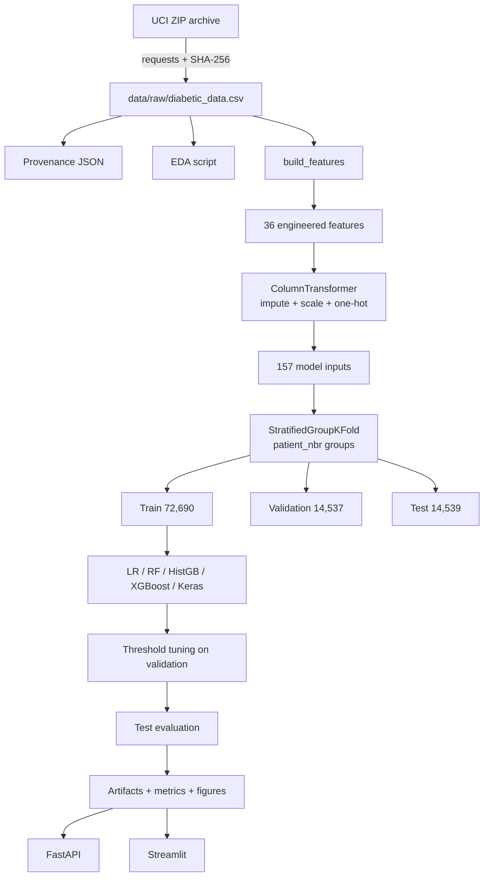
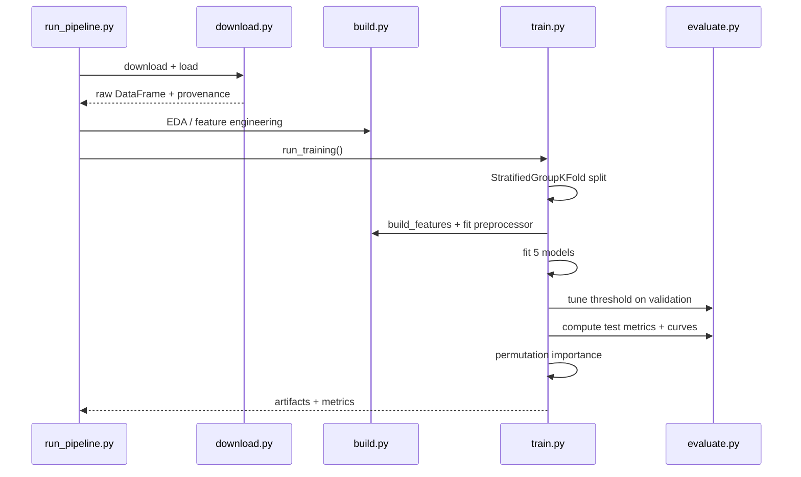
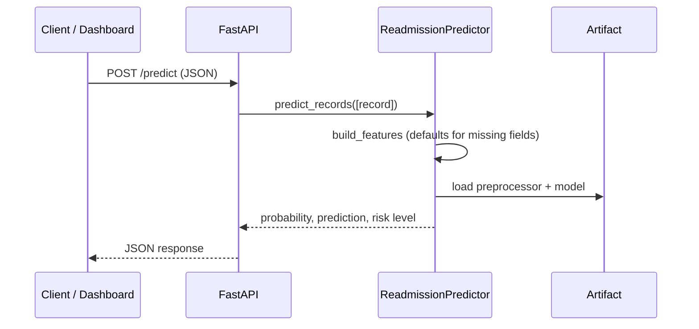
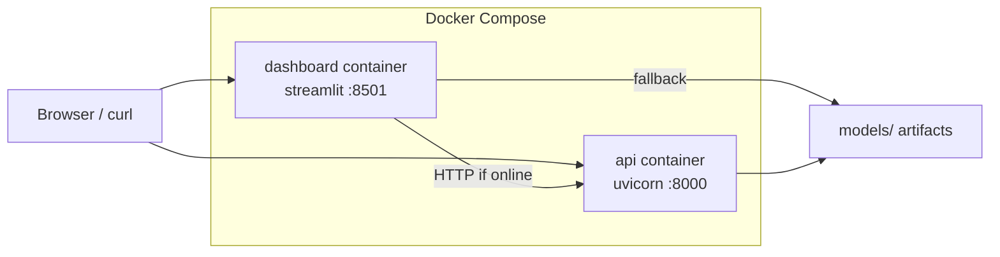

# Architecture

This document describes the data flow, components, contracts and deployment
topology of the readmission prediction pipeline.

## 1. End-to-end data flow

## 2. Components

| Component | Responsibility | Key files |
|---|---|---|
| Configuration | Paths, schema, defaults, seeds, dataset URL | `src/config.py` |
| Acquisition | Download, extraction, checksum, provenance, CSV loading | `src/data/download.py` |
| Feature engineering | Cleaning, ICD-9 grouping, utilization/medication features | `src/features/build.py` |
| Preprocessing | Imputation, scaling, one-hot encoding | `src/features/build.py` |
| Training | Splits, model zoo, tuning, artifact persistence | `src/models/train.py` |
| Evaluation | Metrics, threshold tuning, curves, calibration | `src/models/evaluate.py` |
| Inference | Unified sklearn/Keras scoring wrapper | `src/models/predict.py` |
| API | REST endpoints, validation, batch CSV | `api/main.py`, `api/schemas.py` |
| Dashboard | Analytics, model diagnostics, scoring UI | `dashboard/app.py` |
| Orchestration | One-command pipeline and smoke tests | `scripts/` |
| Quality | Unit, API and artifact tests; lint | `tests/`, `pyproject.toml` |

## 3. Data contracts

### Raw input (`diabetic_data.csv`)

50 columns, one row per inpatient encounter. Important fields:

- Identifiers: `encounter_id`, `patient_nbr` (used only for grouping).
- Demographics: `race`, `gender`, `age`, `weight` (dropped).
- Admission: `admission_type_id`, `discharge_disposition_id`,
  `admission_source_id`, `medical_specialty`.
- Utilization: `time_in_hospital`, `num_lab_procedures`, `num_procedures`,
  `num_medications`, `number_outpatient`, `number_emergency`,
  `number_inpatient`, `number_diagnoses`.
- Clinical: `diag_1..3` (ICD-9), `max_glu_serum`, `A1Cresult`.
- Medication flags: 23 drug columns with values `No`, `Steady`, `Up`, `Down`;
  plus `change` and `diabetesMed`.
- Target: `readmitted` in `{NO, >30, <30}`.

### Engineered features (36)

Numerics: `time_in_hospital`, lab/procedure/medication counts, prior visit
counts, `number_diagnoses`, `age_numeric`, `prior_visits_total`,
`inpatient_ratio`, `emergency_ratio`, `outpatient_ratio`,
`procedures_per_day`, `meds_per_day`, `n_active_meds`, `n_meds_changed`,
`n_meds_up`, `n_meds_down`, `has_prior_inpatient`, `high_utilizer`,
`polypharmacy`.

Categoricals: `race`, `gender`, admission/discharge/source IDs,
`medical_specialty`, `diag_1_group`…`diag_3_group`, `max_glu_serum`,
`A1Cresult`, `insulin`, `diabetesMed`, `change`.

### Artifacts

| Artifact | Description |
|---|---|
| `models/preprocessor.joblib` | Fitted `ColumnTransformer` (157 outputs) |
| `models/best_model.joblib` | Selected scikit-learn `Pipeline` (preprocessor + model) |
| `models/keras_model.keras` | TensorFlow/Keras MLP (always trained, served only if selected) |
| `models/metadata.json` | Model name/type, threshold, metrics, features, versions |
| `reports/metrics/metrics.json` | All-model validation/test metrics + curves |
| `reports/metrics/model_comparison.csv` | Leaderboard table |
| `reports/metrics/feature_importance.csv` | Permutation importance |
| `data/processed/modeling_dataset.parquet` | Raw records + target + split label |

## 4. Training workflow

Key guarantees:

- No patient appears in more than one split (asserted at runtime).
- The preprocessor is fitted on training data only; validation/test use
  `transform`.
- The threshold is tuned on validation; the test set is scored once with the
  frozen threshold.
- All randomness is seeded (`RANDOM_STATE = 42`).

## 5. Inference workflow

Batch requests follow the same path; the API parses CSV, applies defaults for
absent columns, scores every row and streams a CSV with `probability`,
`prediction` and `risk_level` appended.

## 6. Deployment topology

- **API**: stateless; loads artifacts at startup via the FastAPI lifespan hook.
  Returns HTTP 503 when artifacts are unavailable.
- **Dashboard**: prefers the API (`API_URL` env var) and falls back to local
  artifacts so it remains useful during development.
- **Container**: `python:3.12-slim` + `libgomp1` (required by XGBoost), runtime
  requirements only. Trained artifacts and processed data are copied into the
  image.

## 7. Operational considerations

- **Health checks**: `GET /health` reports `model_loaded`.
- **Limits**: batch endpoint caps uploads at 10,000 rows.
- **Validation**: Pydantic enforces categorical domains and numeric ranges;
  invalid payloads return 422.
- **Monitoring (future)**: log prediction distributions, monitor PR-AUC/calibration
  drift, and re-train on newer encounters.
- **Security (future)**: add authentication, TLS, rate limiting and PHI handling
  policies before any production use. This demo uses only de-identified public
  data.
