# Predictive Analytics & AI Model Deployment
## 30-Day Hospital Readmission Prediction — Final Report

**Dataset:** Diabetes 130-US Hospitals for Years 1999-2008 (UCI)
**Author:** Cognevance ML Pipeline Project
**Date:** November 2026

---

## Abstract

This project delivers a complete, reproducible machine learning pipeline that
predicts 30-day hospital readmission for diabetic patients. Using 101,766
de-identified encounters from 130 US hospitals (1999–2008), we engineered 36
clinical and utilization features, expanded them into 157 model inputs, and
compared five models: logistic regression, random forest, histogram gradient
boosting, XGBoost and a TensorFlow/Keras multilayer perceptron. Models were
trained with patient-aware, stratified splits to prevent leakage. XGBoost was
selected on validation PR-AUC and achieved a test PR-AUC of **0.2345** versus a
positive-class prevalence of 0.1116 (2.1× lift), ROC-AUC 0.6748, and F1 0.2877
at a tuned threshold of 0.53 (recall 47.8%, precision 20.6%). The pipeline is
deployed as a FastAPI service with single and batch endpoints, a Streamlit
analytics dashboard, Docker images, automated tests and full documentation.

---

## 1. Introduction

Hospital readmissions are a major quality and cost concern. Early identification
of patients at elevated risk can support discharge planning, follow-up scheduling
and care coordination. This project builds an end-to-end predictive analytics
system for 30-day readmission using routinely collected encounter data.

Objectives:

1. Acquire and document a large clinical dataset.
2. Apply advanced preprocessing and feature engineering.
3. Train and compare multiple machine learning models, including a deep neural
   network.
4. Evaluate discrimination, calibration and clinical trade-offs.
5. Deploy the selected model through an API and an interactive dashboard.
6. Document architecture, reproducibility, limitations and responsible use.

---

## 2. Dataset

| Property | Value |
|---|---|
| Source | UCI Machine Learning Repository, dataset 296 |
| DOI | 10.24432/C5230J |
| License | CC BY 4.0 |
| Encounters | 101,766 |
| Columns | 50 |
| Unique patients | 71,518 |
| Encounters per patient | 1.42 |
| Years | 1999–2008 |
| Hospitals | 130 |
| Positive class | `readmitted == "<30"` (11,357; 11.16%) |
| Negative class | `">30"` or `"NO"` (90,409; 88.84%) |

The dataset contains demographics, admission/discharge information, utilization
counts, 23 medication status columns, laboratory results, ICD-9 diagnosis codes
and the readmission outcome. It is de-identified and publicly available.

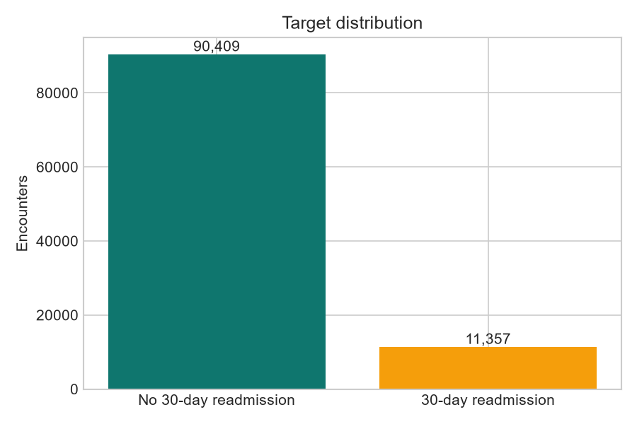

### 2.1 Data quality

Missingness is concentrated in a few columns:

| Column | Missing |
|---|---:|
| `weight` | 96.86% |
| `medical_specialty` | 49.08% |
| `payer_code` | 39.56% |
| `race` | 2.23% |
| `diag_3` | 1.40% |
| `diag_2` | 0.35% |

`weight` and `payer_code` were dropped. `medical_specialty` was retained as a
categorical feature with an explicit `Unknown` level because missingness may
reflect care-process differences. There are no duplicate rows.

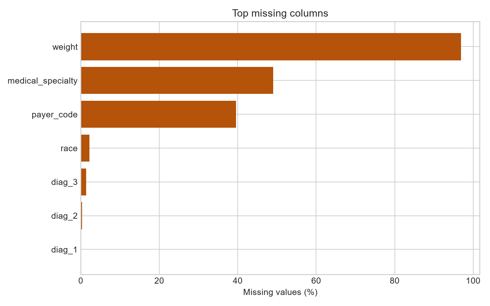

### 2.2 Exploratory findings

- Readmission risk rises with prior inpatient utilization: patients with three
  or more prior inpatient visits have markedly higher rates than those with none.
- Longer index stays are associated with higher readmission rates.
- Patients whose insulin regimen was changed (up or down) show higher rates than
  those with steady or no insulin.
- Age shows a non-linear pattern, with very low rates in children and elevated
  rates in older adults.

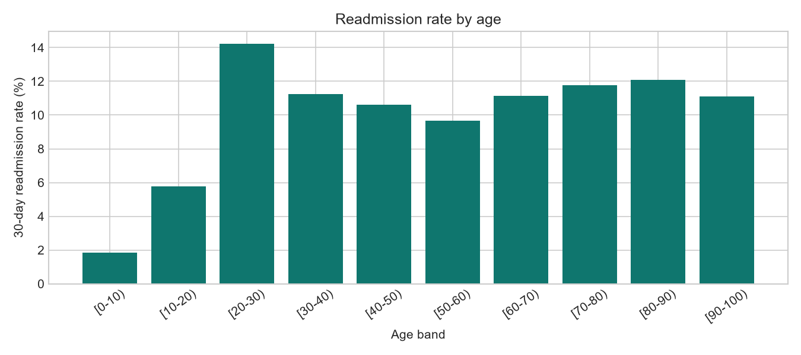

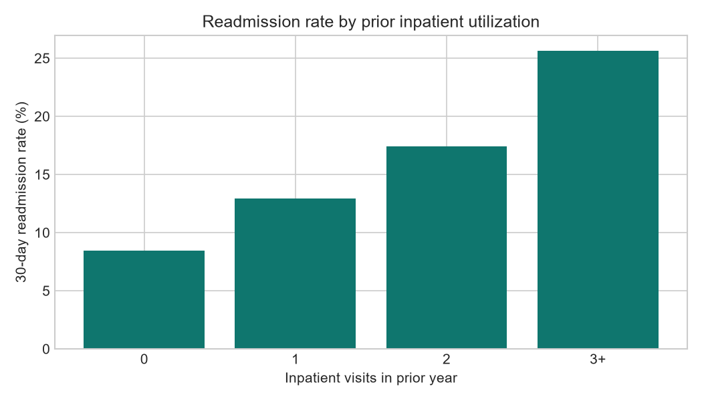

---

## 3. Methodology

### 3.1 Preprocessing

1. Drop identifiers from the feature set and exclude the target.
2. Preserve the literal `None` category for `max_glu_serum` and `A1Cresult`
   (meaning "not measured") while mapping `?` to `Unknown`.
3. Coerce numeric fields and let the pipeline impute missing values.
4. Group ICD-9 diagnosis codes into nine clinical categories: Diabetes,
   Circulatory, Respiratory, Digestive, Injury, Musculoskeletal, Genitourinary,
   Neoplasms, Other, plus Unknown.
5. Convert age bands to midpoints.

### 3.2 Feature engineering

- Medication aggregates: active medications, changed medications, up/down counts.
- Utilization: total prior visits, inpatient/emergency/outpatient ratios.
- Intensity: procedures per day and medications per day.
- Risk flags: prior inpatient, high utilizer (≥3 prior visits), polypharmacy
  (≥15 medications).

The final schema contains 22 numeric and 14 categorical features (36 total).

### 3.3 Preprocessing pipeline

- Numeric: median imputation + standard scaling.
- Categorical: constant imputation + one-hot encoding with rare-category
  grouping (`min_frequency=20`, `handle_unknown="infrequent_if_exist"`).
- Output: 157 dense features.

### 3.4 Splitting strategy

`StratifiedGroupKFold` with 7 folds, grouped on `patient_nbr`:

| Split | Encounters | Positives |
|---|---:|---:|
| Train | 72,690 | 8,113 |
| Validation | 14,537 | 1,622 |
| Test | 14,539 | 1,622 |

Runtime assertions verify that patient groups are disjoint across splits. This
prevents the same patient's repeated encounters from leaking between training
and evaluation.

### 3.5 Models

| Model | Configuration |
|---|---|
| Logistic regression | L2, balanced class weights, max_iter=3000 |
| Random forest | 200 trees, max depth 18, min leaf 10, balanced subsample |
| Histogram gradient boosting | 300 iterations, lr 0.06, 31 leaves, balanced weights, early stopping |
| XGBoost | 400 trees, depth 5, lr 0.05, subsample/colsample 0.8, `scale_pos_weight`, `aucpr` |
| Keras MLP | 128 → 64 → 1, dropout 0.3/0.2, L2, Adam 1e-3, class weights, early stopping on val AUC |

Imbalance handling: balanced class weights for all models and a positive-class
weight for XGBoost. No synthetic minority oversampling was used; class weighting
avoids introducing unrealistic synthetic combinations of one-hot clinical
features.

### 3.6 Threshold selection and metrics

The decision threshold is tuned on the validation set to maximize F1, then frozen
for the test set. Metrics: accuracy, precision, recall, F1, ROC-AUC, PR-AUC,
Brier score, confusion matrix, ROC/PR curves, calibration and permutation
importance. PR-AUC is the primary selection metric because of class imbalance.

---

## 4. Results

### 4.1 Model comparison

| Model | Val PR-AUC | Test PR-AUC | Test ROC-AUC | Test F1 | Test recall | Test precision | Threshold |
|---|---:|---:|---:|---:|---:|---:|---:|
| **XGBoost (selected)** | **0.2291** | **0.2345** | 0.6748 | 0.2877 | 0.4778 | 0.2058 | 0.53 |
| Hist. gradient boosting | 0.2285 | 0.2346 | 0.6754 | 0.2840 | 0.5240 | 0.1948 | 0.52 |
| Keras MLP | 0.2260 | 0.2321 | 0.6753 | 0.2807 | 0.3970 | 0.2171 | 0.59 |
| Logistic regression | 0.2209 | 0.2145 | 0.6677 | 0.2694 | 0.4106 | 0.2004 | 0.56 |
| Random forest | 0.2124 | 0.2147 | 0.6649 | 0.2648 | 0.4920 | 0.1811 | 0.45 |

XGBoost was selected on validation PR-AUC before test evaluation. Histogram
gradient boosting is effectively tied on test (0.2346 vs 0.2345) and has higher
recall; the deployed artifact is XGBoost, but the pipeline makes model swapping
trivial.

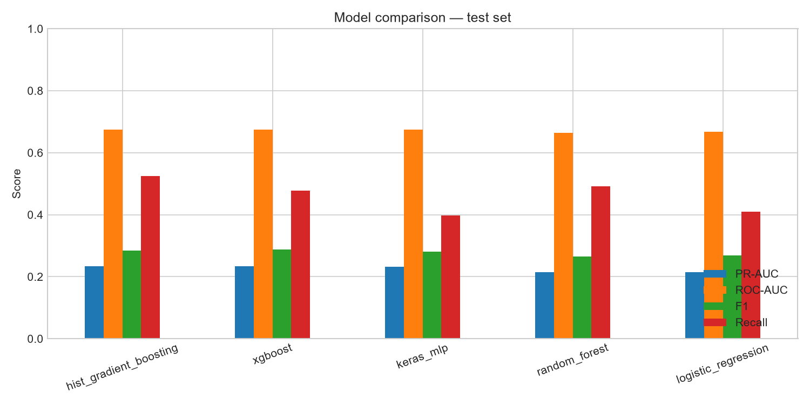

### 4.2 ROC and precision-recall curves

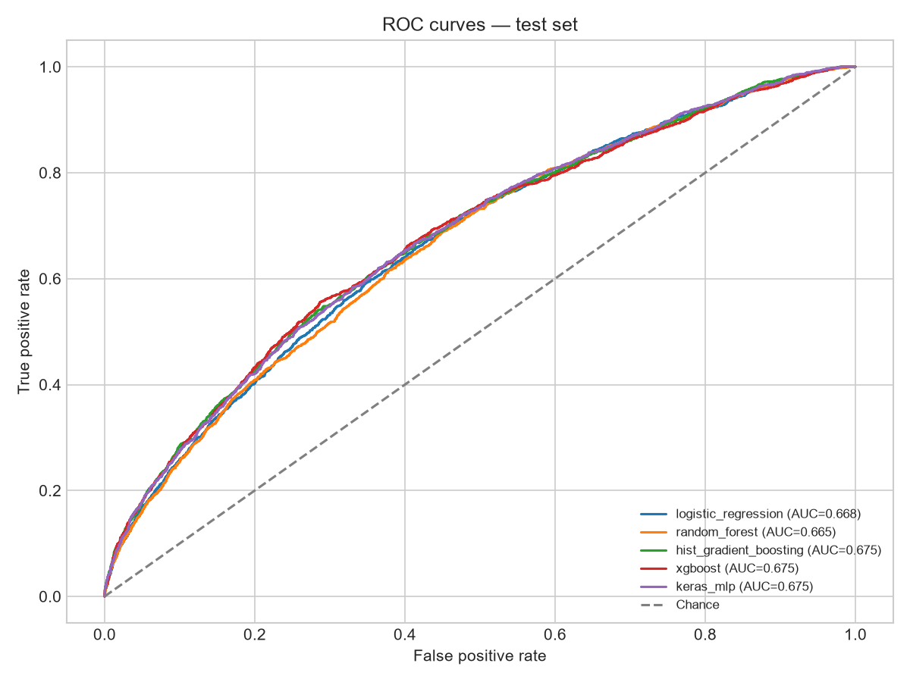

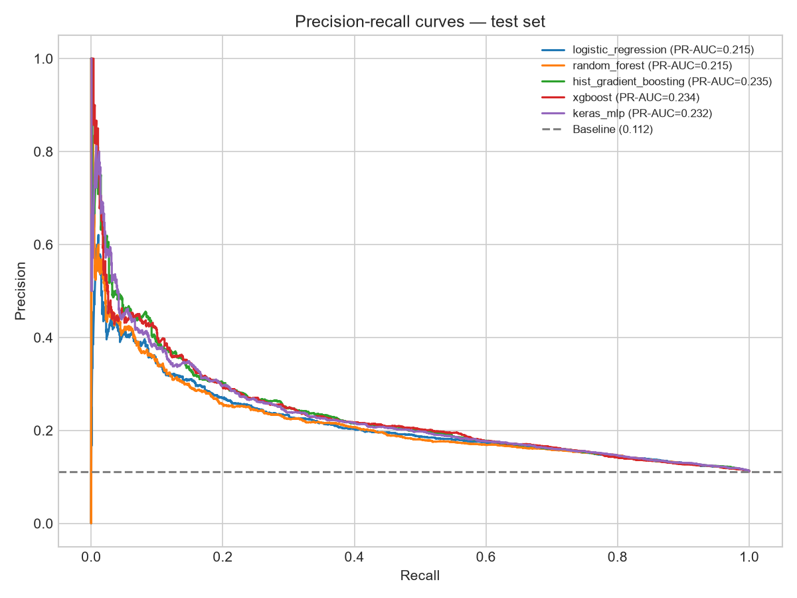

All models achieve ROC-AUC around 0.665–0.675. Precision-recall curves show the
difficulty of the imbalanced task: at ~50% recall, precision is roughly 20%.

### 4.3 Selected model diagnostics

At threshold 0.53 on the test set:

- True negatives: 9,927
- False positives: 2,990
- False negatives: 847
- True positives: 775

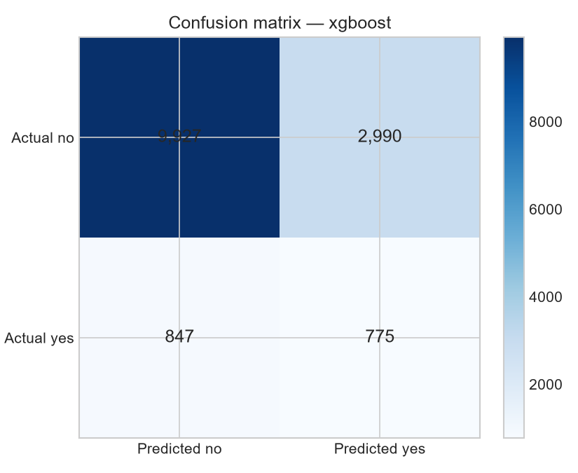

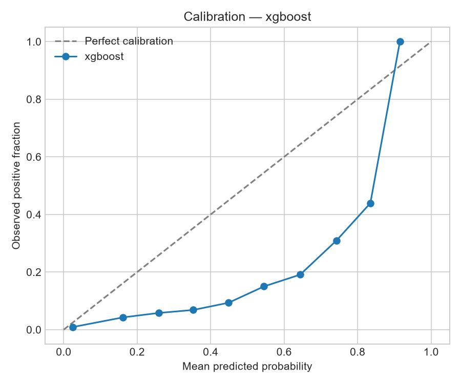

Calibration is imperfect: the model is reasonably calibrated in the mid-range
but tends to over-predict at higher probabilities. Operational use should
therefore rely on the tuned threshold and periodic recalibration.

### 4.4 Feature importance

Top permutation importances (decrease in ROC-AUC):

1. Prior inpatient visits (`number_inpatient`) — 0.0219
2. Inpatient visit ratio — 0.0138
3. Discharge disposition (home) — 0.0126
4. Discharge disposition (expired/hospice) — 0.0119
5. Discharge disposition (other facility) — 0.0098
6. Number of diagnoses — 0.0080
7. Total prior visits — 0.0074
8. Medical specialty (Obstetrics/Gynecology) — 0.0055
9. Length of stay — 0.0044
10. Medical specialty (Cardiology) — 0.0031

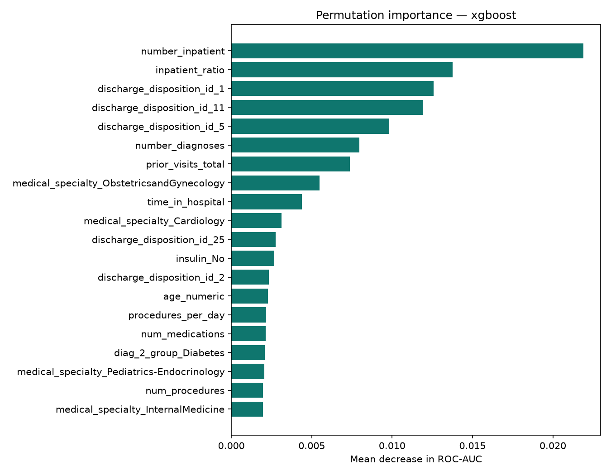

Prior utilization is the dominant signal, consistent with clinical intuition and
the EDA. These are predictive associations, not causal effects.

### 4.5 Deep learning

The Keras MLP (128–64–1) achieved test PR-AUC 0.2321 and ROC-AUC 0.6753. It
trained quickly on CPU, used class weights and early stopping, and performed
comparably to the tree ensembles but with lower recall at its tuned threshold.
Training history is available in `figures/keras_training_curves.png`.

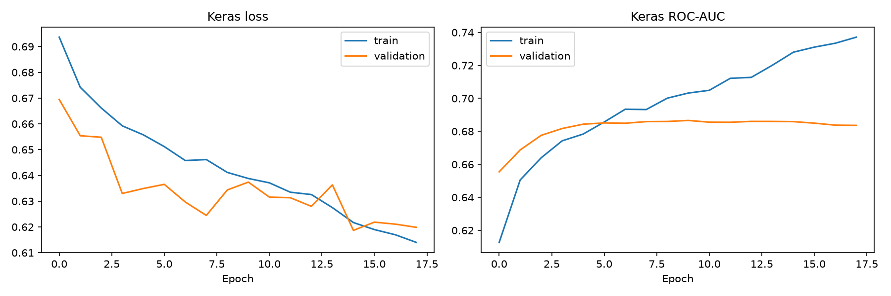

---

## 5. Deployment

### 5.1 REST API (FastAPI)

- `GET /health` — service and model status.
- `GET /model/info` — model name, threshold, metrics and versions.
- `POST /predict` — single encounter with Pydantic validation.
- `POST /predict/batch` — CSV upload (≤10,000 rows), returns scored CSV.

The API loads artifacts at startup and returns 503 if they are unavailable.
Swagger documentation is generated automatically at `/docs`.

### 5.2 Dashboard (Streamlit)

Five pages: Overview (KPIs and leaderboard), Data Insights (interactive
distributions and filters), Model Performance (curves, confusion matrix,
importance), Predict (form-based scoring with a risk gauge) and Batch Predict
(CSV upload and download). The dashboard uses the API when online and falls back
to local artifacts.

### 5.3 Containers

`Dockerfile` builds a Python 3.12 image with `libgomp1` for XGBoost and copies
artifacts, API, dashboard and processed data. `docker-compose.yml` runs the API
on port 8000 and the dashboard on port 8501.

### 5.4 Quality assurance

- 12 pytest tests covering feature engineering, preprocessing, the modeling
  pipeline, API contracts and artifact inference.
- Ruff linting passes with zero findings.
- API smoke test validates health, info, single prediction and batch scoring
  against a live uvicorn server.
- Dashboard smoke test confirms a successful HTTP 200 boot.

---

## 6. Discussion

The task is inherently difficult: readmission depends on post-discharge factors
(adherence, social support, access to care) that are not present in the data.
A PR-AUC of 0.2345 against a 0.1116 baseline is consistent with published
results on this dataset, where AUC-ROC typically ranges from 0.65 to 0.70 and
PR-AUC from 0.20 to 0.27.

Tree ensembles outperform logistic regression, indicating non-linear
interactions among utilization, discharge setting and clinical burden. The deep
MLP is competitive but does not surpass gradient boosting on tabular data, which
is a common finding.

Threshold selection is a policy decision. The deployed threshold of 0.53 yields
high recall (47.8%) at modest precision (20.6%). A care-management program with
limited capacity might prefer a higher threshold to reduce alert volume; a
safety-first program might lower it.

---

## 7. Limitations

1. **No temporal validation** — the random patient-aware split may overestimate
   performance on future encounters. A time-based split is the next step.
2. **Single dataset** — no external hospital validation.
3. **Historical data** — 1999–2008 practice patterns and coding may not reflect
   current care.
4. **Imbalance** — precision is low; alerts require review.
5. **Fairness** — race, gender and age are used without a subgroup audit.
6. **Missingness** — high missingness in weight/payer/specialty; `Unknown`
   categories may encode process differences.
7. **No causality** — feature importance is predictive only.
8. **Not a medical device** — research and educational use only.

---

## 8. Future work

- Temporal and external validation; prospective evaluation.
- Fairness audit across race, gender and age with mitigation strategies.
- Cost-sensitive threshold optimization using readmission and intervention costs.
- SHAP explanations and per-patient reason codes.
- Experiment tracking (MLflow), model registry and automated retraining.
- Monitoring for data drift and calibration drift.
- Authentication, rate limiting and TLS for the API.
- Integration with FHIR/EMR data and clinician-facing workflows.

---

## 9. Reproducibility

```powershell
py -3.12 -m venv .venv
.\.venv\Scripts\Activate.ps1
pip install -r requirements.txt -r requirements-dev.txt
python scripts\run_pipeline.py
```

- Seed: 42 for splits, models and permutation sampling.
- Dataset checksum and shape: `data/raw/provenance.json`.
- Environment versions: `models/metadata.json` → `versions`.
- Tests: `pytest -q`; lint: `ruff check .`.
- Artifacts: `models/`; metrics and figures: `reports/`.

### Project artifacts

| Artifact | Path |
|---|---|
| Source code | `src/`, `scripts/`, `api/`, `dashboard/` |
| Trained model | `models/best_model.joblib` |
| Deep learning model | `models/keras_model.keras` |
| Metadata | `models/metadata.json` |
| Metrics | `reports/metrics/` |
| Figures | `reports/figures/` |
| Architecture | `docs/architecture.md` |
| Model card | `docs/model_card.md` |
| Presentation | `reports/presentation.html` |

---

## 10. References

1. Strack, B., DeShazo, J. P., Gennings, C., Olmo, J. L., Ventura, S., Cios, K. J.,
   & Clore, J. N. (2014). Impact of HbA1c measurement on hospital readmission
   rates: analysis of 70,000 clinical database patient records. *BioMed Research
   International*, 2014, 781670. <https://doi.org/10.1155/2014/781670>
2. UCI Machine Learning Repository. *Diabetes 130-US Hospitals for Years
   1999-2008*. <https://doi.org/10.24432/C5230J> (CC BY 4.0).
3. Chen, T., & Guestrin, C. (2016). XGBoost: A scalable tree boosting system.
   *KDD '16*.
4. Pedregosa, F., et al. (2011). Scikit-learn: Machine learning in Python.
   *JMLR*, 12, 2825–2830.
5. Abadi, M., et al. (2016). TensorFlow: A system for large-scale machine
   learning. *OSDI '16*.
6. FastAPI documentation. <https://fastapi.tiangolo.com>
7. Streamlit documentation. <https://docs.streamlit.io>
